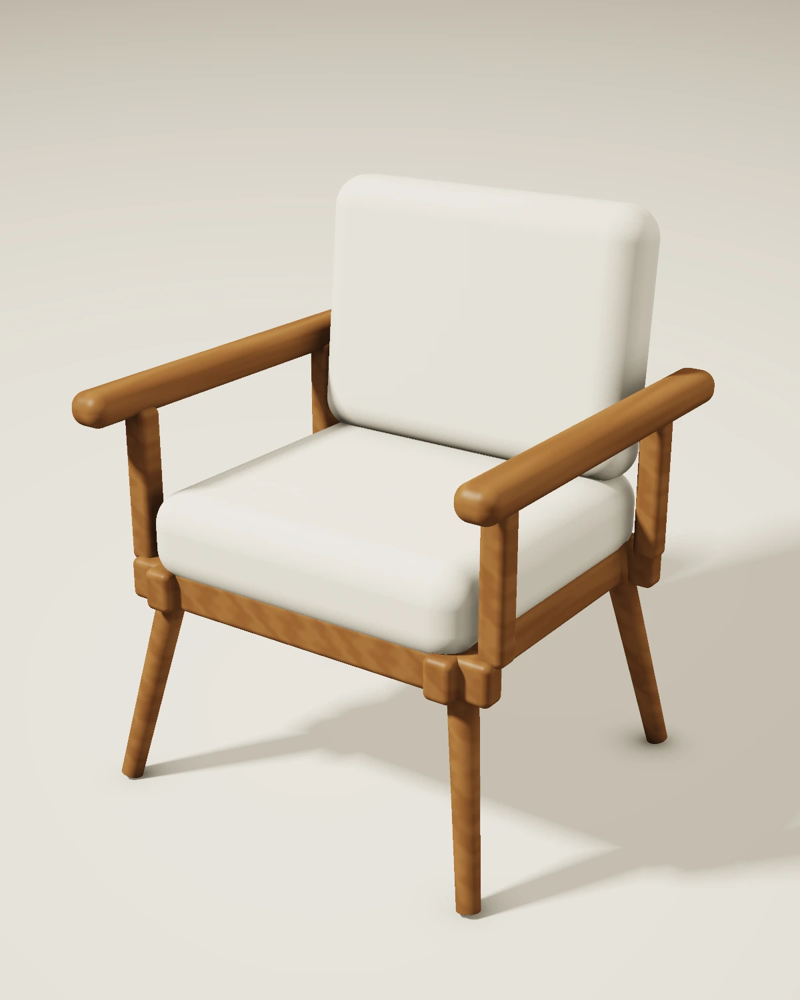

# LUMA 01 — учебный предметный 3D-кейс

[Открыть кейс](https://safal207.github.io/safonov-interior-portfolio/cases/luma-01.html) · [English](https://safal207.github.io/safonov-interior-portfolio/en/cases/luma-01.html) · [Исходники](../assets/luma01/source/)

**Задача:** создать визуальную презентацию концептуального кресла с тёплым деревянным каркасом и светлой тканевой обивкой.

**Процесс:** процедурная геометрия, материалы дерева и ткани, свет и камеры. Сцена создана с помощью кода и ИИ. Все ракурсы и анимация используют общие параметры `scene.json`.

**Результат:** четыре изображения 1200 × 1500, MP4 с полным оборотом камеры (6 секунд, 24 кадра/с, 720 × 900), геометрия GLB/OBJ и код для воспроизведения.

**Что можно проверить:** устройство сцены, параметры геометрии, постоянство формы между ракурсами, код освещения/материалов и воспроизведение рендера. GLB и OBJ содержат геометрию и базовые цвета; процедурные фактуры не запечены в текстуры модели.

**Статус:** учебный концепт без заказчика и коммерческих результатов. Конструкция не проходила инженерную проверку. Производственные чертежи и точное соответствие реальному образцу не заявляются. Кейс сам по себе не подтверждает самостоятельное владение Blender, 3ds Max или Corona.

| Основной ракурс | Фронт | Профиль | Сзади |
| --- | --- | --- | --- |
| [PNG](../assets/luma01/hero.png) | [PNG](../assets/luma01/front.png) | [PNG](../assets/luma01/profile.png) | [PNG](../assets/luma01/rear.png) |

[MP4](../assets/luma01/LUMA01_turntable.mp4) · [GLB](../assets/luma01/source/LUMA01.glb) · [ZIP с исходниками и OBJ](../assets/luma01/LUMA01_source.zip)
